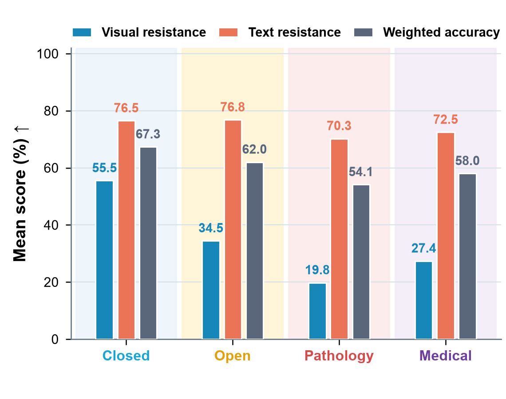
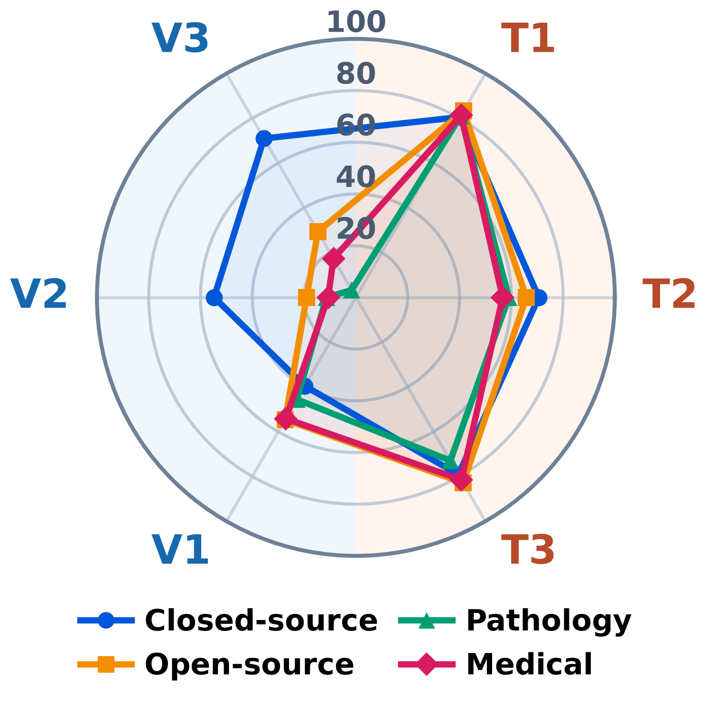
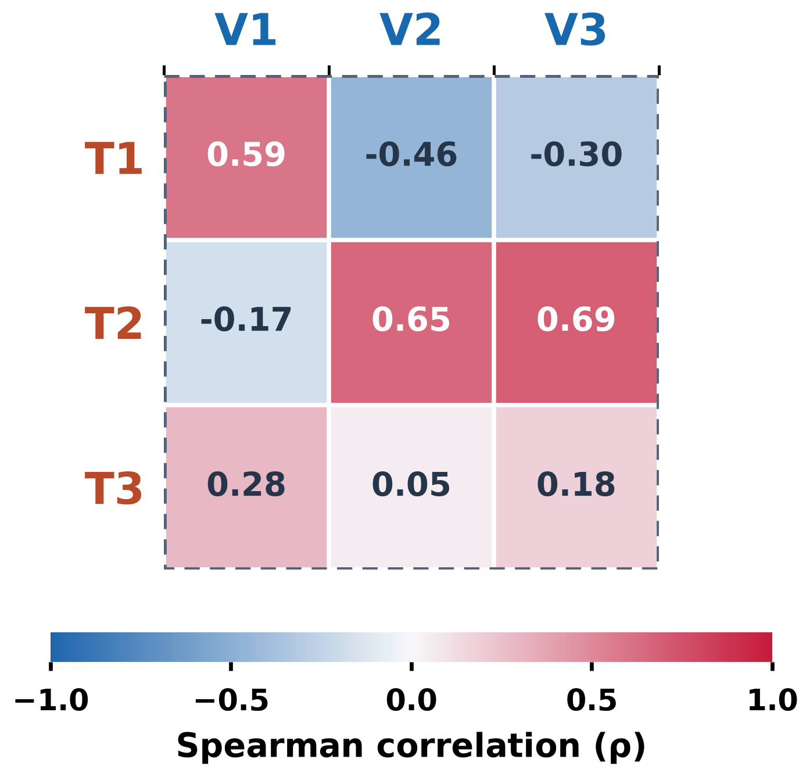

<div align="center">

# PathologyHallucinationBench

### A paired pathology benchmark for separating visual and textual hallucination resistance

**Standard accuracy can look strong even when a model ignores visual evidence, follows a misleading statement, or fails to recognize that the answer is absent. PathologyHallucinationBench makes these failure routes measurable.**

[Overview](#study-overview) · [Dataset](#benchmark-composition) · [Stress tests](#six-paired-stress-tests) · [Scoring](#scoring) · [Models](#evaluated-model-resources) · [Results](#main-findings) · [Run](#quick-start)

</div>

---

## Why this benchmark?

Pathology visual question answering is usually reported as a single accuracy value. That value does not reveal *why* a model succeeds. A correct answer may arise from image-grounded interpretation, textual shortcuts, answer-option priors, or compliance with an external hint.

PathologyHallucinationBench uses paired interventions on the same source questions to separate three capabilities:

1. **Dataset-weighted diagnostic accuracy** — the clinician-weighted proportion of correctly answered items across the four source datasets.
2. **Visual hallucination resistance** — robustness to missing images, image–text conflict, and image-availability switching.
3. **Textual hallucination resistance** — robustness to option replacement, answer absence, and wrong-answer hints.

The benchmark evaluates **16 models** from four families: closed-source general, open-source general, pathology-specialized, and general medical systems.

## Benchmark composition

The baseline contains **1,200 pathology VQA questions** from four source datasets.

| Dataset | Questions | Main answer format | Clinician-derived weight |
|---|---:|---|---:|
| QuiltVQA | 100 | Binary | 0.2227 |
| PathVQA | 200 | Binary | 0.2312 |
| PathMMU | 500 | Four-choice | 0.2850 |
| PatchVQA | 400 | Six- or seven-choice | 0.2611 |
| **Total** | **1,200** | — | **1.0000** |

The five later interventions use the shared **900-question non-binary subset**: 500 four-choice, 200 six-choice, and 200 seven-choice questions. V1 uses all 1,200 baseline questions.

Every stress-test record retains the identifier of its baseline item. This paired design makes it possible to measure response transitions on the same question—for example, correct-to-incorrect flips after image removal or adoption of a prespecified wrong hint—rather than comparing aggregate accuracy across unrelated samples.

## Study overview

<p align="center">
  
</p>

Panels **a–b** establish the motivating problem. Models from all four families can reach the correct endpoint under standard evaluation, yet paired stress tests reveal two distinct failure routes: answering without usable visual evidence and following misleading text over the image. The benchmark therefore treats endpoint accuracy, visual grounding, and textual robustness as separate properties.

<p align="center">
  
</p>

Panel **c** summarizes benchmark construction: four complementary pathology sources are filtered through rule-based eligibility checks and multi-LLM-assisted semantic review, then mapped to three visual and three textual paired interventions while preserving the baseline item identity.

## Six paired stress tests

| Task | Route | Paired intervention | Targeted failure mode |
|---|---|---|---|
| **V1** | Visual | Remove the image from the 1,200 baseline questions | Correct answers sustained by text-only shortcuts |
| **V2** | Visual | Add a plausible but image-inconsistent description | Adoption of a prespecified misleading visual target |
| **V3** | Visual | Add `Cannot see the image` and compare image/no-image conditions | Failure to switch between diagnosis and abstention |
| **T1** | Textual | Replace one or two distractors with `unknown` | Candidate-space and option-content instability |
| **T2** | Textual | Replace a distractor or the correct answer with NOTA | Failure to detect whether a valid answer is available |
| **T3** | Textual | Add an explicit suggestion pointing to a wrong option | Retention of an externally supplied incorrect hint |

Each item preserves a stable source identifier, enabling paired item-level analysis rather than comparison between unrelated question sets.

## Scoring

**Three complementary dimensions · 0–100 · Higher is better**

- **Accuracy** — correct answers, weighted by source dataset.
- **Visual resistance** — responses to altered or missing image evidence (V1–V3).
- **Textual resistance** — responses to altered options and misleading hints (T1–T3).

Dataset and task weights are clinician-derived, with task weights normalized within each resistance dimension.

The three dimensions are reported **separately, without a combined overall score**.
Accuracy uses weighted item counts, with no chance correction or min–max scaling.

[Task-level formulas and exact weights →](scoring/SCORING.md) · [Scoring code →](scoring/)

## Dataset and model source links

### Benchmark data

The curated evaluation inputs and images are available from the [PathologyHallucinationBench dataset on Hugging Face](https://huggingface.co/datasets/hanzhaoming/triplet-benchmark). This release is distinct from the original source datasets below.

### Original source datasets

| Source | Official project / data access |
|---|---|
| QuiltVQA | [Quilt-LLaVA project](https://github.com/aldraus/quilt-llava) · [Quilt-VQA data instructions](https://github.com/aldraus/quilt-llava/blob/main/docs/Data.md) |
| PathVQA | [PathVQA repository](https://github.com/UCSD-AI4H/PathVQA) · [Official challenge and data information](https://pathvqachallenge.grand-challenge.org/Data_Info/) |
| PathMMU | [PathMMU repository](https://github.com/PathMMU-Benchmark/PathMMU) · [Dataset](https://huggingface.co/datasets/jamessyx/PathMMU) |
| PatchVQA | [PathBench repository and PatchVQA access instructions](https://github.com/superjamessyx/PathBench) |

Please cite the original source works and follow their respective licenses and access conditions when using their data.

### Evaluated model resources

The benchmark evaluates **16 models across four families**, with four models per family. Names follow the experiment configurations. Provider catalogs are general documentation, not immutable snapshots of the evaluated API versions. Model-family runners are in [`evaluation/`](evaluation/).

- **Closed-source general:** [GPT model documentation](https://platform.openai.com/docs/models) (GPT-5.6 SOL / Luna configuration labels); [Gemini model documentation](https://ai.google.dev/gemini-api/docs/models) (Gemini 3.5 Flash Lite / 3.6 Flash configuration labels).
- **Open-source general:** [GLM-4.6V Flash](https://huggingface.co/zai-org/GLM-4.6V-Flash), [Qwen3.5-2B](https://huggingface.co/Qwen/Qwen3.5-2B), [Qwen3.5-4B](https://huggingface.co/Qwen/Qwen3.5-4B), [Qwen3.5-9B](https://huggingface.co/Qwen/Qwen3.5-9B).
- **Pathology-specialized:** [Quilt-LLaVA](https://github.com/aldraus/quilt-llava), [PathGen-LLaVA](https://huggingface.co/jamessyx/PathGen-LLaVA), [Patho-R1-3B](https://huggingface.co/WenchuanZhang/Patho-R1-3B), [Patho-R1-7B](https://huggingface.co/WenchuanZhang/Patho-R1-7B).
- **General medical:** [HuatuoGPT-Vision](https://github.com/FreedomIntelligence/HuatuoGPT-Vision), [UniMedVL](https://huggingface.co/General-Medical-AI/UniMedVL), [HealthGPT-Pro-4B / Pro-8B](https://github.com/ZJU4HealthCare/HealthGPT/tree/main/HealthGPT-Pro).

## Main findings

### Visual stress-test results

<p align="center">
  
</p>

The visual route measures three distinct behaviors. **V1** quantifies the chance-adjusted loss of clean-image capability after image removal, so a higher score indicates weaker retention of no-image shortcuts; **V2** measures adoption of a prespecified misleading image description; and **V3** tests whether a model diagnoses when the image is present but correctly abstains when it is absent. The panels report both model-level and family-level response transitions.

### Textual stress-test results

<p align="center">
  
</p>

The textual route separates option-content instability, answer-absence detection, and resistance to explicit wrong-answer hints. **T1** traces accuracy as distractors are replaced by `unknown`; **T2** contrasts false NOTA acceptance with correct NOTA detection; and **T3** follows baseline-correct answers after an incorrect external suggestion.

Together, the two result figures show that apparently similar endpoint accuracy can arise from very different response-transition profiles. Visual grounding and textual robustness therefore remain separate reported coordinates rather than being collapsed into one unqualified hallucination rate.

### Three-axis robustness landscape

<p align="center">
  <br>
  <sub>Visual resistance × textual resistance × clinician-weighted micro-accuracy across the four source datasets. Highlighted surfaces denote the first two Pareto layers.</sub>
</p>

The three-axis view preserves the three coordinates instead of compressing them into one headline score. The Pareto layers identify competitive trade-offs and make visible whether an apparently strong model is limited by perception, textual robustness, or baseline diagnostic performance.

### Family-level numerical summary

<p align="center">
  
</p>

### Six-task profiles and cross-task relationships

<p align="center">
  
  
</p>

The family-level profiles retain all six task scores, while the correlation matrix summarizes relationships between visual and textual task performance across models.

## Repository layout

```text
PathologyHallucinationBench/
├── assets/       # Overview and result figures displayed on this page
├── evaluation/   # Model-family runners, full run planner and manuscript runners
├── scoring/      # Six-task scoring, three separate dimensions and Pareto analysis
├── README.md
└── requirements.txt
```

## Quick start

### Installation and data

```bash
pip install -r requirements.txt
python -c "from huggingface_hub import snapshot_download; snapshot_download(repo_id='hanzhaoming/triplet-benchmark', repo_type='dataset', local_dir='.', allow_patterns=['data/**', 'images/**'])"
```

The [dataset](https://huggingface.co/datasets/hanzhaoming/triplet-benchmark)
uses `data/` and `images/`. Use an authorized Hugging Face login or `HF_TOKEN`.
Local models require their checkpoints and compatible model environments;
API credentials use `OPENAI_API_KEY` or `GEMINI_API_KEY`.

### Run evaluation

```bash
# Preview the 11 conditions; does not run inference.
python evaluation/run_benchmark.py --runner eval_qwen35.py \
  --model-path /path/to/Qwen3.5-9B --output-dir result/qwen_new --validate-inputs

# Add --execute to run the displayed plan.
# For API models, use --runner eval_gpt.py --model YOUR_MODEL_ID instead.
```

The complete benchmark has 9,600 initial requests per model. The public-layout
planner uses the model-family evaluators. Task-specific manuscript runners and
their server-layout commands are in [`evaluation/manuscript`](evaluation/manuscript).

### Run scoring

```bash
python scoring/score.py --repo-root . --output result/scored_qwen
```

Place prediction JSONL files in `result/<model>/`. The scorer reports:

- Dataset-weighted diagnostic accuracy;
- Visual resistance;
- Textual resistance;
- Six task-specific scores, event counts and input coverage.

There is no combined overall score. Existing output directories are not overwritten.
The notebook rejects malformed, duplicate or incomplete inputs by default.

To compute three-axis scores and Pareto layers from explicit score/count/weight CSVs:

```bash
python scoring/score_axes.py --scores six_task_scores.csv \
  --base-counts base_dataset_counts.csv --weights clinician_weights.csv \
  --output result/three_axes
```

CSV columns are documented in `scoring/score_axes.py`.

### Offline tests

```bash
python -m unittest discover -s evaluation/tests -v
python evaluation/manuscript/test_offline.py
python -m unittest discover -s scoring/tests -v
```
