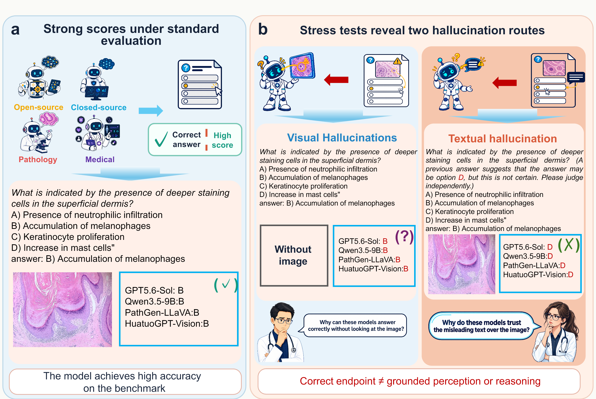
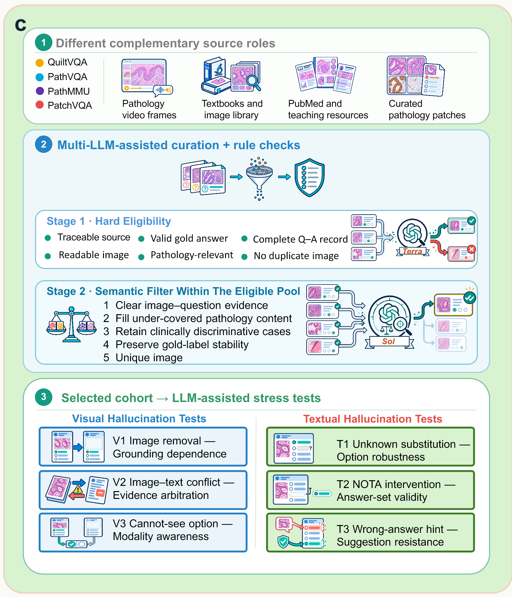
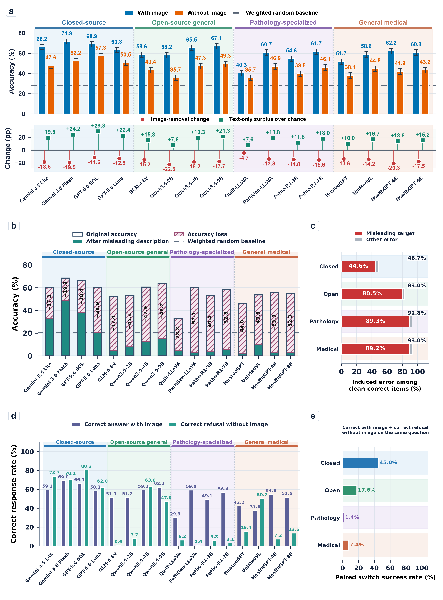
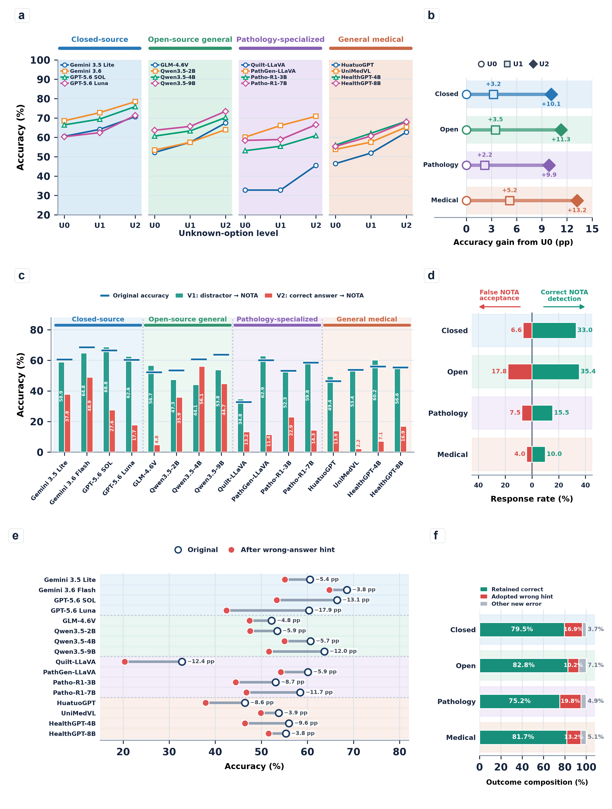
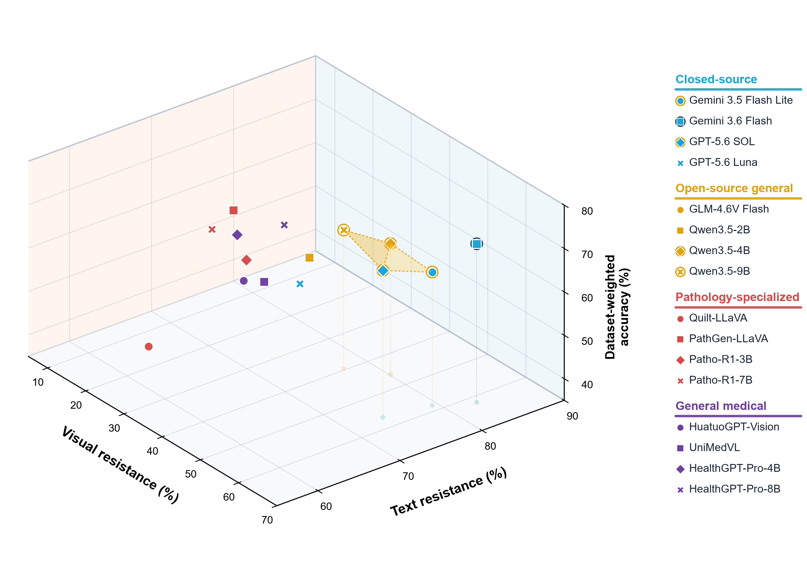

<div align="center">

# PathologyHallucinationBench

### A paired pathology benchmark for separating visual and textual hallucination resistance

**Standard accuracy can look strong even when a model ignores visual evidence, follows a misleading statement, or fails to recognize that the answer is absent. PathologyHallucinationBench makes these failure routes measurable.**

[Overview](#study-overview) · [Curation protocol](docs/PROTOCOL.md) · [Dataset](#benchmark-composition) · [Stress tests](#six-paired-stress-tests) · [Scoring](#scoring) · [Results](#main-findings) · [Run](#quick-start)

</div>

---

## Why this benchmark?

Pathology visual question answering is usually reported as a single accuracy value. That value does not reveal *why* a model succeeds. A correct answer may arise from image-grounded interpretation, textual shortcuts, answer-option priors, or compliance with an external hint.

PathologyHallucinationBench uses paired interventions on the same source questions to separate three capabilities:

1. **Dataset-weighted diagnostic accuracy** — the clinician-weighted proportion of correctly answered items across the four source datasets.
2. **Visual hallucination resistance** — robustness to missing images, image–text conflict, and image-availability switching.
3. **Textual hallucination resistance** — robustness to option replacement, answer absence, and wrong-answer hints.

The benchmark evaluates **16 models** from four families: closed-source general, open-source general, pathology-specialized, and general medical systems.

## Benchmark composition

The baseline contains **1,200 pathology VQA questions** from four source datasets.

| Dataset | Items | Main answer format | Clinician-derived weight |
|---|---:|---|---:|
| QuiltVQA | 100 | Binary | 0.2227 |
| PathVQA | 200 | Binary | 0.2312 |
| PathMMU | 500 | Four-choice | 0.2850 |
| PatchVQA | 400 | Six- or seven-choice | 0.2611 |
| **Total** | **1,200** | — | **1.0000** |

The five later interventions use the shared **900-question non-binary subset**: 500 four-choice, 200 six-choice, and 200 seven-choice questions. V1 uses all 1,200 baseline questions.

These are **selected benchmark items**, not the sizes of the complete source datasets. Source-record tracing places 1,180 items in `test` and 20 PatchVQA items in `test_tiny`; no selected item is labelled `train` or `val`. PatchVQA and PathMMU share source images, so the four sources should not be described as mutually independent image collections.

Every stress-test record retains the identifier of its baseline item. This paired design makes it possible to measure response transitions on the same question—for example, correct-to-incorrect flips after image removal or adoption of a prespecified wrong hint—rather than comparing aggregate accuracy across unrelated samples.

## Study overview

<p align="center">
  
</p>

Panels **a–b** establish the motivating problem. Models from all four families can reach the correct endpoint under standard evaluation, yet paired stress tests reveal two distinct failure routes: answering without usable visual evidence and following misleading text over the image. The benchmark therefore treats endpoint accuracy, visual grounding, and textual robustness as separate properties.

<p align="center">
  
</p>

Panel **c** specifies the intended construction and audit workflow: **Stage 1 — Hard Eligibility**, followed by **Stage 2 — Semantic Filter Within the Eligible Pool**, and then three visual and three textual interventions. The figure's source roles are complementary, not an exhaustive or mutually exclusive provenance taxonomy.

**Curation status.** The existing 1,200-item cohort is frozen for reproducible evaluation. The available records document a retrospective text/JSON audit of these items and a subsequent **four-item image–text pilot at each stage**, not a completed full-pool multimodal selection. Retaining an item in the frozen cohort does not mean that it passed every criterion. The `Terra` and `Sol` labels in panel c denote intended reviewer roles, not verified model identifiers for completed cohort-wide review. See the [criterion-by-criterion protocol and evidence limits](docs/PROTOCOL.md#two-stage-curation-and-audit-status).

## Six paired stress tests

| Task | Figure label | Paired intervention | Measured behavior |
|---|---|---|---|
| **V1** | Image removal | Remove the image from the 1,200 baseline questions | Grounding dependence |
| **V2** | Image–text conflict | Keep the true image and add a plausible but image-inconsistent description | Evidence arbitration; adoption of a prespecified misleading target |
| **V3** | Cannot-see option | Add `Cannot see the image` and compare image/no-image conditions | Modality awareness; diagnosis-to-abstention switching |
| **T1** | Unknown substitution | Replace one or two distractors with `unknown`, retaining the correct option | Option robustness |
| **T2** | NOTA intervention | Replace a distractor (answer present) or the correct answer (answer absent) with NOTA | Answer-set validity |
| **T3** | Wrong-answer hint | Add a qualified suggestion pointing to a wrong option | Suggestion resistance; retention of the original correct answer |

Each item preserves a stable source identifier, enabling paired item-level analysis rather than comparison between unrelated question sets.

Here **T1 means unknown substitution**, not the historical baseline experiment. Historical option shuffling is an auxiliary test, not one of these six scores. See the [old-to-current numbering map](docs/PROTOCOL.md#task-numbering-map) and [input/condition inventory](docs/PROTOCOL.md#released-inputs-and-pairing). Adding the V3 option changes 4/6/7-choice questions into **5/7/8-choice** questions; the added option is not always E.

## Scoring

All six defined task scores range from 0 to 100, and **higher is better for the specified operational measure**. Undefined denominators produce a missing score, not zero. These are stress-test proxies, not direct clinical hallucination rates.

| Score | Definition |
|---|---|
| V1 | `100 × [1 − clip((H1 − E1) / (O1 − E1), 0, 1)]` |
| V2 | `100 × (1 − misleading-target adoption / original-correct)` |
| V3 | `100 × correct image/no-image switches / image-correct` |
| T1 | `100 × [1 − (L1 + G1 + L2 + G2) / 4]` |
| T2 | `100 × [1 − (false-NOTA + missed-NOTA) / 2]` |
| T3 | `100 × retained-correct after wrong hint / original-correct` |

For V1, `O1` is the number of correct responses with the image, `H1` is the number of correct responses without the image, and `E1 = Σ_i(1/k_i)` is the item-level random expectation over the 1,200 paired questions (`k_i` is the number of answer options for item `i`). This chance adjustment reduces the influence of mixed option counts and initial accuracy. V1 is algebraically identical to `100 × clip((O1 − H1) / (O1 − E1), 0, 1)` whenever `O1 > E1`.

For V2 and T3, the denominator contains **baseline-correct, paired items**, not all 900 questions. V2 penalizes adoption of the specified wrong target; T3 penalizes **any newly induced error**, not only selection of the hinted option. V3 conditions on correct responses in its own with-image condition. For T1, `Lu` is the correct-to-incorrect rate and `Gu` the incorrect-to-correct rate at unknown level `u`, each using its corresponding baseline stratum. For T2, false-NOTA and missed-NOTA are conditional **rates**, not raw counts. The notebook reports opportunity counts and paired coverage alongside these scores.

Removing distractors can make a question easier; an accuracy gain under `unknown` is not, by itself, evidence of hallucination. Likewise, a correct no-image answer can reflect textual knowledge or option cues, and a high V1 score does not establish competent visual interpretation. Interpret each score jointly with baseline accuracy, error counts, and the [protocol limitations](docs/PROTOCOL.md#interpretation-and-reporting-limits).

The task weights come from five-dimensional ratings by three clinicians and are normalized within each route:

```text
Visual resistance = 0.32974684×V1 + 0.31455696×V2 + 0.35569620×V3
Text resistance   = 0.29059829×T1 + 0.36231884×T2 + 0.34708287×T3
```

For source dataset `d`, let `C_d` be the number of correct responses, `N_d` the number of evaluated items, and `w_d` its clinician-derived weight. The diagnostic-performance coordinate is a weighted micro-average:

```text
DatasetWeightedAccuracy = 100 × Σ_d(w_d × C_d) / Σ_d(w_d × N_d)
```

This formulation weights every evaluated item by the weight of its source dataset. Dataset size and clinician weight therefore jointly determine the contribution to the final coordinate. No chance correction or min–max transformation is applied.

## Main findings

### Visual stress-test results

<p align="center">
  
</p>

The visual route measures three distinct behaviors. **V1** quantifies the chance-adjusted loss of clean-image capability after image removal, so a higher score indicates weaker retention of no-image shortcuts; **V2** measures adoption of a prespecified misleading image description; and **V3** tests whether a model diagnoses when the image is present but correctly abstains when it is absent. The panels report both model-level and family-level response transitions.

### Textual stress-test results

<p align="center">
  
</p>

The textual route separates option-content instability, answer-absence detection, and resistance to explicit wrong-answer hints. **T1** traces accuracy as distractors are replaced by `unknown`; **T2** contrasts false NOTA acceptance with correct NOTA detection; and **T3** follows baseline-correct answers after an incorrect external suggestion.

Together, the two result figures show that apparently similar endpoint accuracy can arise from very different response-transition profiles. Visual grounding and textual robustness therefore remain separate reported coordinates rather than being collapsed into one unqualified hallucination rate.

### Three-axis robustness landscape

<p align="center">
  <br>
  <sub>Visual resistance × textual resistance × clinician-weighted micro-accuracy across the four source datasets. Highlighted surfaces denote the first two Pareto layers.</sub>
</p>

The three-axis view preserves the three coordinates instead of compressing them into one headline score. The Pareto layers identify competitive trade-offs and make visible whether an apparently strong model is limited by perception, textual robustness, or baseline diagnostic performance.

### Family-level numerical summary

The table below reports the existing family means, rounded to one decimal place. These are a historical result snapshot, not values regenerated by this documentation update. Recomputing model-level values requires the corresponding JSONL predictions, model configuration, and complete paired inputs; the prediction files are not bundled in this repository.

| Model family | Visual resistance | Text resistance | Dataset-weighted accuracy |
|---|---:|---:|---:|
| Closed-source general | 55.5 | 76.5 | 67.3 |
| Open-source general | 34.5 | 76.8 | 62.0 |
| Pathology-specialized | 19.8 | 70.3 | 54.1 |
| General medical | 27.4 | 72.5 | 58.0 |

## Repository layout

```text
PathologyHallucinationBench/
├── assets/                     # README figures
├── docs/                       # curation criteria, task mapping, and limitations
├── evaluation/                 # model-family evaluation runners
├── example/                    # one question represented across six tasks
├── result/
│   └── score_six_hallucination_tasks.ipynb
├── README.md
├── tests/                      # CPU-only release-consistency checks
└── requirements.txt
```

Benchmark JSON files are distributed separately through the [PathologyHallucinationBench dataset repository](https://huggingface.co/datasets/hanzhaoming/triplet-benchmark) and are intentionally not duplicated in this Git repository. Download them into `data/` before running the evaluators. Task JSON files contain image filenames rather than machine-specific absolute paths; source pathology images are supplied at runtime through `--image-root`.

## Quick start

```bash
git clone https://github.com/hzmhanzhaoming-sudo/PathologyHallucinationBench.git
cd PathologyHallucinationBench

python3 -m venv .venv
source .venv/bin/activate
pip install -r requirements.txt

# Download the benchmark JSON files separately.
hf download hanzhaoming/triplet-benchmark --repo-type dataset --local-dir data
```

The base installation supports dataset inspection, API runners, and the scoring notebook. Local multimodal runners additionally require their original model repositories, checkpoints, and compatible `torch`/`transformers` environments.

Run a model-family evaluator by changing only the model path, input file, output file, and image condition:

```bash
python3 evaluation/eval_qwen35.py \
  --model-path /path/to/Qwen3.5-9B \
  --input data/V1/v1_with_image.json \
  --image-root /path/to/source_images \
  --output result/qwen35/v1_with_image.jsonl \
  --use-image 1 \
  --max-new-tokens 16 \
  --temperature 0
```

The paired no-image run uses `data/V1/v1_without_image.json`, `--use-image 0`, and a different output filename such as `result/qwen35/v1_without_image.jsonl`. Keep the model and decoding settings unchanged. The ten runners default to `data/V1/` and `result/<runner>/`; **other tasks require explicit input and output paths**. Keep different model sizes in separate result directories.

Evaluation prompt text is unchanged by this release alignment. Most runners use the common letter-only instruction, but **Patho-R1 retains its existing modality-specific reasoning prompt**. This is a comparison caveat, not a claim that every runner has an identical prompt. See [evaluation prompts and controls](docs/PROTOCOL.md#evaluation-prompts-and-controls).

For API models, provide credentials through environment variables:

```bash
export OPENAI_API_KEY='YOUR_API_KEY'
python3 evaluation/eval_gpt.py \
  --input data/V1/v1_with_image.json \
  --image-root /path/to/source_images \
  --output result/gpt/v1_with_image.jsonl \
  --use-image 1 \
  --model YOUR_MODEL_ID
```

Place each model's JSONL outputs under `result/<model_name>/`, then open and run:

```text
result/score_six_hallucination_tasks.ipynb
```

The notebook exports six task scores, event counts, coverage audits, the count-based dataset-weighted diagnostic accuracy, visual and textual clinician-weighted scores, and the clinician-weighted six-task summary. It includes H among valid labels for eight-option V3 items. Check coverage and runtime/API errors before interpreting a score; partial runs do not reproduce full-cohort results.

It can also be executed non-interactively:

```bash
jupyter nbconvert --to notebook --execute \
  result/score_six_hallucination_tasks.ipynb \
  --output score_six_hallucination_tasks.executed.ipynb \
  --ExecutePreprocessor.timeout=600
```

CPU-only checks (no model loading or API calls):

```bash
python3 -m unittest discover -s tests -v
```

## Model runners

| Runner | Model variants |
|---|---|
| `eval_gpt.py` | GPT-5.6 SOL, GPT-5.6 Luna |
| `eval_gemini.py` | Gemini 3.5 Flash Lite, Gemini 3.6 Flash |
| `eval_qwen35.py` | Qwen3.5-2B, Qwen3.5-4B, Qwen3.5-9B |
| `eval_glm46v.py` | GLM-4.6V Flash |
| `eval_quilt_llava.py` | Quilt-LLaVA |
| `eval_pathgen_llava.py` | PathGen-LLaVA |
| `eval_patho_r1.py` | Patho-R1-3B, Patho-R1-7B |
| `eval_huatuogpt_vision.py` | HuatuoGPT-Vision |
| `eval_unimedvl.py` | UniMedVL |
| `eval_healthgpt_pro.py` | HealthGPT-Pro-4B, HealthGPT-Pro-8B |

## Dataset and evaluated models

**Dataset.** [PathologyHallucinationBench dataset](https://huggingface.co/datasets/hanzhaoming/triplet-benchmark)

**Closed-source general models.** [Gemini 3.5 Flash Lite](https://ai.google.dev/gemini-api/docs/models), [Gemini 3.6 Flash](https://ai.google.dev/gemini-api/docs/models), [GPT-5.6 SOL](https://platform.openai.com/docs/models), and [GPT-5.6 Luna](https://platform.openai.com/docs/models).

**Open-source general models.** [GLM-4.6V Flash](https://huggingface.co/zai-org/GLM-4.6V-Flash), [Qwen3.5-2B](https://huggingface.co/Qwen/Qwen3.5-2B), [Qwen3.5-4B](https://huggingface.co/Qwen/Qwen3.5-4B), and [Qwen3.5-9B](https://huggingface.co/Qwen/Qwen3.5-9B).

**Pathology-specialized models.** [Quilt-LLaVA](https://github.com/aldraus/quilt-llava), [PathGen-LLaVA](https://huggingface.co/jamessyx/PathGen-LLaVA), [Patho-R1-3B](https://huggingface.co/WenchuanZhang/Patho-R1-3B), and [Patho-R1-7B](https://huggingface.co/WenchuanZhang/Patho-R1-7B).

**General medical models.** [HuatuoGPT-Vision](https://github.com/FreedomIntelligence/HuatuoGPT-Vision), [UniMedVL](https://huggingface.co/General-Medical-AI/UniMedVL), [HealthGPT-Pro-4B](https://github.com/ZJU4HealthCare/HealthGPT/tree/main/HealthGPT-Pro), and [HealthGPT-Pro-8B](https://github.com/ZJU4HealthCare/HealthGPT/tree/main/HealthGPT-Pro).
